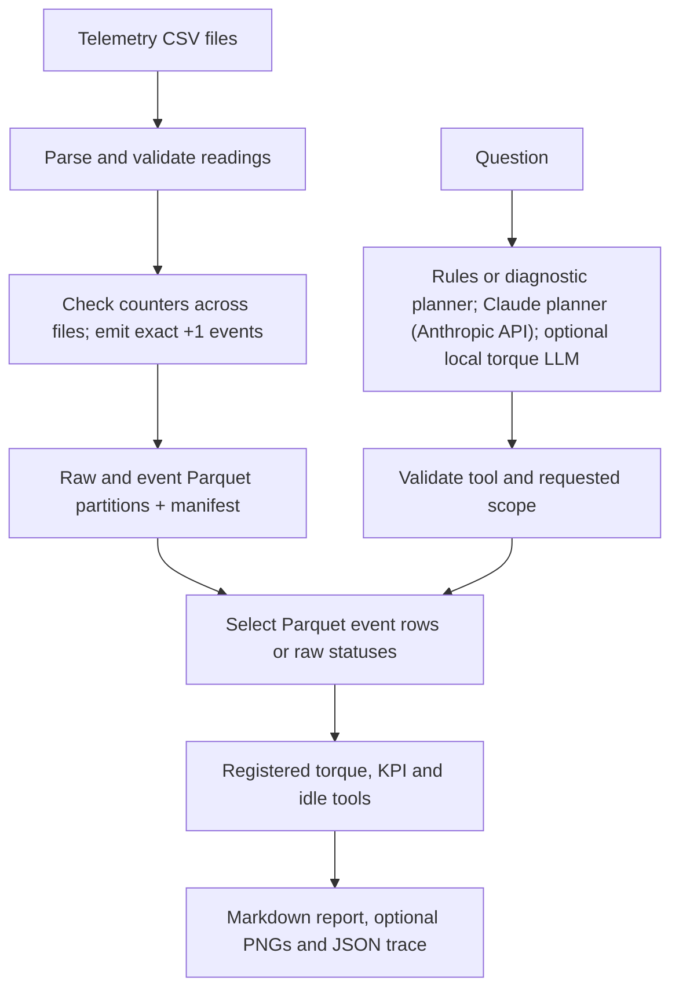

# AROL Telemetry AI

An industrial telemetry analysis project for an AROL capping machine. It converts timestamped, per-head counter readings into **observed closure events**, lets a scoped question select registered analyses, and produces a Markdown report with a JSON execution trace. The CLI routes questions deterministically by default; a [Claude planner](#claude-planner-everyday-wording) understands everyday wording across all tools (the website's default when an Anthropic key is set), and a local Ollama planner is available for a narrower set of torque questions. In every mode the numbers come from deterministic tools, never from a model.

> **Scope of the numbers:** An event represents an observed counter change of exactly `+1` between successive readings. Larger jumps and decreases are measured but are not reconstructed into individual closures. Results therefore describe **observed events**, not all physical production.

## Contents

- [Requirements and installation](#requirements-and-installation)
- [Try it yourself: demo data](#try-it-yourself-demo-data)
- [Run without private telemetry](#run-without-private-telemetry)
- [Prepare a real event pool](#prepare-a-real-event-pool)
- [Ask questions and inspect results](#ask-questions-and-inspect-results)
- [Architecture](#architecture)
- [Analysis tools](#analysis-tools)
- [Optional local LLM](#optional-local-llm)
- [Claude planner (everyday wording)](#claude-planner-everyday-wording)
- [Data definitions and limits](#data-definitions-and-limits)
- [Project layout and further reading](#project-layout-and-further-reading)
- [Troubleshooting](#troubleshooting)

## Requirements and installation

- Python **3.12** and `git`. The examples use a Unix/macOS shell; on Windows, activate `.venv` with the equivalent Windows command.
- Enough free disk space for your private CSV files and generated raw/event Parquet partitions if you plan to build a real pool. The repository does **not** include those private CSVs or built pools.
- Ollama and a downloaded model **only if** you choose the optional local LLM planner. Rules routing, tests, and the controlled evaluation need no model.
- An Anthropic API key, internet access and a small API budget **only if** you use the [Claude planner](#claude-planner-everyday-wording). Without them everything else works and the website uses the rules.
- Python 3.12 or newer. The full suite and evaluations were verified on Python 3.14.3 / Windows 11; the CI workflow (`.github/workflows/tests.yml`) runs them on Python 3.12 and 3.14 on Linux and Windows once the branch is pushed. `requirements-lock.txt` pins every package of the verified environment (`pip install -r requirements-lock.txt` for an identical setup).

From a new checkout:

```bash
git clone https://github.com/EddyKhoury/arol-telemetry-ai.git
cd arol-telemetry-ai
python3.12 -m venv .venv
.venv/bin/python -m pip install --upgrade pip
.venv/bin/python -m pip install -r requirements-dev.txt   # runtime packages + pytest
.venv/bin/python -m pip install -r requirements-web.txt   # only for the Streamlit website
.venv/bin/python -m pytest tests -q
```

Run commands from the **repository root**. Runtime packages are pinned in `requirements.txt` (Polars and Parquet for processing, PyYAML for configuration, the Anthropic SDK for the optional Claude planner); `requirements-dev.txt` adds pytest and `requirements-web.txt` adds Streamlit. Without Streamlit the one website test is skipped. Tests never contact a model API, even when a key is set. Running `pytest tests -q` selects the actual suite and avoids accidentally collecting backed-up test files stored elsewhere in a local working directory.

On Windows, substitute `.venv\Scripts\python` for `.venv/bin/python` in the commands below. If `python3.12` is unavailable, install Python 3.12 first and check `python3.12 --version`.

## Try it yourself: demo data

The AROL telemetry is private and is not in this repository, so anyone else
needs data to try the app. `scripts/build_demo_pool.py` generates one made-up
day for machine `DEMO01` (36 heads, one reading per second, 960,840 observed
events, UTC) in the same CSV format and runs it through the normal pool
builder. It is deterministic, takes a few seconds, and is written to the
ignored `data/demo_pool/`. It contains planted signals to find:

| Planted signal | Ask (example in the website list) |
| --- | --- |
| Head 7 is weak (about 3% rejects, 97.0% success) | `Rank heads by cap-present success rate for machine DEMO01 on 2026-02-01` |
| Head 12 torque drifts up about 0.1 Nm/h, 08:00-12:00 | `Show torque trend for head 12 for machine DEMO01 from 2026-02-01T06:00:00 until 2026-02-01T12:00:00` |
| Head 3 has three 2.8 Nm closures (10:15, 14:30, 18:45) | `Find torque anomalies for head 3 for machine DEMO01 on 2026-02-01` |
| 01:00-01:30 the machine runs without caps | `Machine idle for machine DEMO01 from 2026-02-01T00:00:00 until 2026-02-01T06:00:00` |

**Quickest start (anyone, no setup knowledge needed):** install Python 3.12 or
newer, download or clone the repository, then double-click `start.bat`
(Windows) or run `sh start.sh` (macOS/Linux). It creates `.venv`, installs the
packages, creates a `.env` file and opens the website in your browser.

Or manually, after installing (see below):

```bash
.venv/bin/python -m scripts.demo_agent --demo --question "show me the failure rate for each head"
.venv/bin/streamlit run app/streamlit_app.py
```

The website uses the demo data automatically when no private pool exists (or
when `AROL_DEMO=1`), and says so in a yellow banner. Without an Anthropic key it
answers with the offline rules (use the example questions); with a key, Claude
understands everyday wording.

### Using Claude: everyone uses their own key

Nobody needs the team's key, and no key is ever stored in the repository. Each
tester uses their own key from https://console.anthropic.com, in any of these ways:

| Where | How | Kept |
| --- | --- | --- |
| Website sidebar | Paste it into *Your Anthropic API key* | Only for that browser session; never saved or logged |
| `.env` file | `ANTHROPIC_API_KEY=sk-ant-...` (copy `.env.example` to `.env`) | On your computer only; `.env` is ignored by Git |
| Environment | Set `ANTHROPIC_API_KEY` | On your computer only |

`config.yaml` and `config.local.yaml` refuse any key (the app stops with an
error), so one cannot be committed by accident. Each question costs the key's
owner well under one cent; the tests never use a key.

### Power test (accuracy, scale, robustness)

`scripts/showcase.py` asks the system a battery of questions and checks every
number against an **independent calculation made directly from the Parquet
files with plain Polars** (not the project's tools):

```bash
.venv/bin/python -m scripts.showcase                    # demo data; Claude too if a key is set
.venv/bin/python -m scripts.showcase --manifest data/event_pools/<pool>/manifest.json --scale <manifest> <manifest>
```

It writes a branded scorecard (`data/showcase/<stamp>/scorecard.html`). The
recorded run in `docs/showcase/scorecard.html` (real February telemetry plus the
demo data, Claude and the rules) gave:

| Check | Result |
| --- | --- |
| Accuracy: 12 analyses x 2 datasets x 2 planners | **48/48** right analysis with exactly matching numbers |
| Robustness: typos, Italian, vague dates, impossible heads, prompt injection, off-topic | **12/12** answered correctly or asked; nothing invented |
| Scale: whole-pool totals | 0.8 M events in 0.4-0.7 s; 2.3 M in 0.4-1.0 s; **21.9 M events (28 days) in 3.4-12.5 s** |

### Put the website online (free)

The app can be hosted on Streamlit Community Cloud so testers only need a link.
It runs on the demo data and the offline rules, so it costs nothing and no
private data or API key leaves your computer.

1. Push the branch to GitHub (the repository is public).
2. Sign in at https://share.streamlit.io with the GitHub account that can see the repository.
3. *Create app* > *Deploy a public app from GitHub*: repository `EddyKhoury/arol-telemetry-ai`,
   the branch, main file path `app/streamlit_app.py`. Under *Advanced settings*
   choose Python 3.12. Do **not** add an Anthropic key as a secret: every visitor's
   question would be billed to it.
4. Deploy. The first start builds the demo data (a few seconds); then share the link.

`app/requirements.txt` installs the runtime and website requirements. Hosted
apps sleep after a period without visitors and wake up on the next visit.

## Run without private telemetry

The full code tests and the small, controlled question evaluation work in a clean checkout:

```bash
.venv/bin/python -m pytest tests -q
.venv/bin/python -m scripts.evaluate_agent
.venv/bin/python -m scripts.evaluate_anomaly_ground_truth
```

The evaluator creates a tiny **synthetic two-file telemetry pool** with planted signals and four boundary events. It checks 28 fixed questions: 16 supported requests must produce the exact plan and result, and 12 requests must ask for clarification without loading event data. Results, synthetic files, reports, and traces are written locally; the score measures this controlled suite, **not** accuracy on arbitrary language or real production.

The separate anomaly evaluation uses [predeclared fixture labels](benchmarks/evaluation/anomaly_truth_v1.json) and two synthetic event pools. It matches returned flags to event IDs and reports true positives, false positives, missed labels, precision, recall and the false positive rate. The first case tests two planted torque limit breaches across a file boundary; the second includes a subtler in-range deviation. Results from the uploaded source ZIP: **TP=4, FP=0, FN=1, TN=59; precision=100%, recall=80%, false positive rate=0%**. These are scores on **synthetic torque-deviation labels**, not diagnoses of actual machine faults. See [the evaluation methods](docs/EVALUATION.md) and [the recorded evidence](benchmarks/integration/anomaly_ground_truth_v1.json).

For a committed, clean Git checkout, you can also run:

```bash
.venv/bin/python -m scripts.check_clean_checkout
```

The evaluators leave tracked files untouched by default: `scripts.evaluate_agent` writes its evidence into its run folder under `data/`, and `scripts.build_event_pool` next to the pool. Pass `--record` to promote a run to `benchmarks/integration/` and append a checkpoint to `docs/PROJECT-AUDIT.md` and `docs/INTEGRATION-TRACKER.md`; commit those changes before running the clean-checkout check, which refuses to run on a modified tree.

This runs tests and the controlled evaluation from a temporary detached checkout with the current virtual environment. It requires `git status --short` to show no changes and does not test dependency installation, private telemetry, or a live model. In a previous release review the clean checkout reported **848 passed, 4 skipped** (936 passed, 4 skipped on the `audit-followups` branch), then **28/28** controlled cases; these are recorded historical results, not promised counts for future revisions. Current results come from the commands you run.

## Prepare a real event pool

Place the original telemetry CSVs in a local directory under `data/`, for example `data/telemetry_...csv`. Keep filenames and their chronological order intact. Private CSVs and built pools under `data/` are ignored by Git and are **not downloaded** by this project. The CSV schema must provide `timestamp` and per-head `Count`, `AppTorque`, and `Status` columns.

Inspect the builder arguments, then create a **new** pool directory:

```bash
.venv/bin/python -m scripts.build_event_pool --help
.venv/bin/python -m scripts.build_event_pool \
  --machine-id MCC777eda3db57348ef8a3113a642ae74db \
  --pattern 'data/telemetry_MCC777eda3db57348ef8a3113a642ae74db_2026-*.csv' \
  --output data/event_pools/my-pool
```

Adjust the machine ID, glob, and output directory to your data. Quote the pattern so **the builder** receives it; its files are processed in sorted filename order. The example assumes files named like the supplied 2026 dataset. The output directory must not already exist. Building a large pool may take time and disk space; it is a separate operation from asking a question.

The builder validates whole-number counters before conversion, carries each head's previous observation across file boundaries, records jumps/decreases, and emits Parquet event partitions only for exact `+1` transitions. `data/event_pools/my-pool/manifest.json` is written when the build completes; a failed build may leave a partial directory without a complete manifest. An optional `--audit PATH` compares selected summary counts with an existing full counter audit; it does not independently validate every event field.

For the project's previously verified 89-file local dataset, the manifest recorded **7,623,968 raw rows**, **36 heads**, **54,722,936 observed exact `+1` events**, and **667 cross-file exact `+1` transitions**. These figures identify that specific local build, not the expected size of another dataset.

## Ask questions and inspect results

Start by printing questions with a machine ID and time window taken from *your* manifest:

```bash
.venv/bin/python -m scripts.demo_agent \
  --manifest data/event_pools/my-pool/manifest.json \
  --examples
```

Replace the manifest path below with your completed pool and adjust the machine, head, and dates to match. The window's start is **inclusive** and its end is **exclusive**:

```bash
.venv/bin/python -m scripts.demo_agent \
  --manifest data/event_pools/my-pool/manifest.json \
  --question 'Average torque for head 5 for machine MCC777eda3db57348ef8a3113a642ae74db from 2026-02-01T00:00:00 until 2026-02-01T12:00:00 for successful closures'
```

Other supported examples (using the same machine and time window):

```bash
.venv/bin/python -m scripts.demo_agent --manifest data/event_pools/my-pool/manifest.json \
  --question 'Success rate for head 5 for machine MCC777eda3db57348ef8a3113a642ae74db from 2026-02-01T00:00:00 until 2026-02-01T12:00:00'

.venv/bin/python -m scripts.demo_agent --manifest data/event_pools/my-pool/manifest.json \
  --question 'Success rate by hour for machine MCC777eda3db57348ef8a3113a642ae74db from 2026-02-01T00:30:00 until 2026-02-01T03:15:00'

.venv/bin/python -m scripts.demo_agent --manifest data/event_pools/my-pool/manifest.json \
  --question 'Compare head 5 with peers by cap-present success rate for machine MCC777eda3db57348ef8a3113a642ae74db from 2026-02-01T00:00:00 until 2026-02-01T12:00:00'

.venv/bin/python -m scripts.demo_agent --manifest data/event_pools/my-pool/manifest.json \
  --question 'Machine idle for machine MCC777eda3db57348ef8a3113a642ae74db from 2026-02-01T00:00:00 until 2026-02-01T01:00:00'
```

Omit `--question` for an interactive prompt (`exit` to leave); repeat `--question` for several reports. Pass `--json` with scripted questions to emit structured JSON, or `--output DIR` to change where sessions are saved. If exactly one complete pool exists under `data/event_pools/`, `--manifest` can be omitted; otherwise select it explicitly.

Add `--plots` when asking for a histogram, trend, time series, head KPI or
No Load intervals. It saves PNG figures from returned tool results and links
them in the Markdown report. See [three synthetic example reports](docs/samples/README.md)
or recreate them using `.venv/bin/python -m scripts.generate_sample_reports`.

Every question gets its own Markdown report and JSON trace under `data/demo_runs/session-.../question-.../`. The report states the filters, event population, definitions, numerical findings, and limits; the trace lists planning, loading, tool calls, and any clarification or error. Unsupported or ambiguous questions produce `needs_clarification` with **zero analysis tool calls**. For example, asking an unrelated general-knowledge question does not turn this project into a general chatbot. The CLI returns exit status `2` for a non-`ok` result, while still saving the report and trace.

For the local website, install `requirements-web.txt`, then run `.venv/bin/streamlit run scripts/web_demo.py` from the repository root and open the local URL it prints. It uses the pool named by the `AROL_MANIFEST` environment variable, otherwise the presentation pool if present, otherwise the only pool under `data/event_pools/`. The sidebar chooses how questions are understood: Claude (default when `ANTHROPIC_API_KEY` is set) or the deterministic rules described here. The page clearly shows the selected machine. Ask `Is there any problem with head 4?` and it will request a bounded time window before reading events. With a window, it compares confirmed cap-present success against eligible peers and checks torque flags through registered tools. The short diagnostic answer and the detailed report state the observed evidence and why it cannot establish a yes/no fault verdict. The page exposes planned calls, the execution trace, and tool results. The same route is available in the CLI with `--planner diagnostic`, where the machine must be named in the question.

After changing backend Python files while Streamlit is running, restart the local server. A page rerun can retain an older imported planner module even while showing updated page code.

The source limits **materialized** events to **1,000,000** per request (`data.max_loaded_events`). Questions answered by totals (torque statistics, success rate, success rate per head) have no such limit: above it they are computed while scanning the Parquet partitions, without loading the events, and the report says so (for example average torque over 2,290,224 events in about 0.2 s). Tools that need individual rows (histogram, trend, anomalies, head comparisons, time buckets, idle) keep the limit; narrow the machine, head, or time window when such a query exceeds it. A one-day trend returns at most `analytics.trend_max_points` (2,000) points of its moving-average series; the slope and drift always use every point. A peer comparison deliberately loads the other heads in the same machine/time window, because the specified head is the focus of the comparison.

## Architecture

The system has an **offline build path** and an **online question path**. The builder preserves validated observed events in a partitioned pool. The question path plans an analysis, reads only its supported scope, executes registered deterministic tools, and reports the result and its provenance.



| Stage | Main code | Responsibility |
| --- | --- | --- |
| CSV and event building | `src/ingestion/conversion.py`, `src/ingestion/event_pool.py`, `src/ingestion/event_table_polars.py`, `scripts/build_event_pool.py` | Parse raw columns, validate counters, carry prior rows across files, decode and save observed event partitions and manifest. |
| Question planning | `src/agent/planner.py`, `src/agent/*_routing.py`, `src/agent/claude_planner.py`, `src/agent/llm_validation.py` | Select supported tools and exact parameters (rules, or Claude for everyday wording); reject ambiguous, invalid or out-of-pool scope before dispatch. |
| Scoped source | `src/common/event_pool_source.py`, `src/common/datasource.py`, `src/ingestion/adapter.py` | Validate the manifest, select relevant Parquet rows, preserve original event fields, and enforce the materialization limit. |
| Analysis | `src/common/registry.py`, `src/common/runtime.py`, `src/analytics/registered_*.py` | Validate tool arguments, apply the requested scope, run deterministic analytics and return structured results with units and counts. |
| Orchestration and output | `src/agent/orchestrator.py`, `src/agent/report.py`, `src/agent/trace.py`, `scripts/demo_agent.py` | Run the plan, record failures and timing, assemble a report, and save a trace. |

Person A implemented the CSV ingestion, observed event construction, and core torque analytics. Person B implemented the agent planner/orchestration, shared tool registry, reporting, traces, and related analyses. Their integration connects the partitioned event source to registered torque and explicit-denominator KPI tools. The separate project reference guides describe individual functions and ownership in greater detail.

## Analysis tools

| Question type | Registered tool(s) | What it reports |
| --- | --- | --- |
| Torque summary | `torque_stats` | Mean, minimum, maximum, sample standard deviation, and finite sample size. |
| Torque histogram | `torque_distribution` | Counts across specified bins. |
| Torque trend | `torque_trend` | Time-oriented torque summary. |
| Torque flags | `detect_torque_anomalies` | Configured limit and statistical flags; a flag does not identify a cause. |
| Two-head torque comparison | `head_correlation` | Matched observed torque pairs for two distinct heads. |
| Explicit KPI counts | `success_rate`, `success_rate_per_head` | Observed events, confirmed cap-present population, success and reject fractions, unknowns, and legacy fraction labelled separately. |
| Head ordering and peers | `rank_heads_by_success`, `compare_head_success` | Descriptive cap-present success ranking and focus-versus-peer median within one machine/time window. |
| Time buckets | `kpi_over_time`, `observed_throughput` | Hourly/daily counts and rates over requested durations, including clipped and empty intervals, plus a separate incremental mean of bucket rates. |
| All-head No Load | `machine_idle` | Candidate intervals where every raw status reading is No Load for the configured sustained duration. |

Some questions intentionally call two compatible tools in one scoped load, such as summary + histogram or total + per-head KPI. Those tools may use the *same* observations; their sample sizes must not be added together.

## Optional local LLM

The default `--planner rules` routes supported wording deterministically and needs no model. `--planner llm` talks to an Ollama server at `http://localhost:11434` using the model configured in `agent.llm.model` (default `qwen2.5-coder:14b`). You can override the model in a local `config.local.yaml`:

```yaml
agent:
  llm:
    model: qwen2.5-coder:14b
    fallback_to_rules: false
    timeout_seconds: 60
    temperature: 0
    seed: 42
```

Then check that Ollama is running and the chosen tag appears in `ollama list`, and ask one supported torque question:

```bash
.venv/bin/python -m scripts.demo_agent \
  --manifest data/event_pools/my-pool/manifest.json \
  --planner llm \
  --question 'Average torque for head 5 for machine MCC777eda3db57348ef8a3113a642ae74db from 2026-02-01T00:00:00 until 2026-02-01T01:00:00 for successful closures'
```

**Important:** `config.local.yaml` is not listed in the current `.gitignore`; keep local machine settings and any secrets out of commits. No API key is required for localhost Ollama. `--planner llm` is an **experimental torque planner** restricted to five verified single-tool torque analyses. Its existing scope validator rejects changed arguments, combined analyses, KPI questions, and head-health questions before data access. Transport fallback to rules, when enabled, is labelled in the trace. The website's head diagnostic is a separate evidence-based route and does not use this LLM mode.

## Claude planner (everyday wording)

The rules only recognise the documented phrasings. `--planner claude` sends the question to the Anthropic API, where Claude chooses among **all twelve registered tools** and their arguments. "How hard did spindle 5 tighten caps on February 1st?" becomes `torque_stats` for `H05`, `2026-02-01T00:00:00` to `2026-02-02T00:00:00`, without the exact vocabulary. Relative days ("yesterday", "this morning") get a clarification question when the pool spans more than one day, because recorded data has no "today".

| Entry point | Default planner |
| --- | --- |
| CLI `scripts.demo_agent` | `rules` (pass `--planner claude`) |
| Website `scripts/web_demo.py` | `claude` when `ANTHROPIC_API_KEY` is set, otherwise the deterministic `diagnostic` rules; switch in the sidebar or set `AROL_PLANNER` |

What stays the same:

- Tools compute every number. Claude's text is used only as a clarification question, never as a finding.
- Every proposal is validated before data is loaded: the tool must be registered, the argument names must be known, heads must be canonical (`H05`) and present in the pool, timestamps naive (`YYYY-MM-DDTHH:MM:SS`) with start before end and overlapping the data, `bins` between 1 and 200, and the tool combination must be supported. Invalid proposals are rejected, never repaired. Settings the tools do not accept (sigma, window lengths, thresholds) get a clarification instead of being silently ignored.
- Each report has an **`Interpreted as:`** line, so you can check what Claude understood. The model that answered and its token usage are in the trace.
- Sent to Anthropic: the system prompt, the tool descriptions, the question text (which may contain machine IDs), and the pool's machine ID, head list and time range. Telemetry rows and tool results stay local.
- If no key is configured or the API is unreachable, overloaded or rejects the key, the deterministic `diagnostic` rules answer instead and the trace shows `claude->rules (fallback)`. Other API errors (for example a wrong model name) are reported as a clarification rather than hidden behind the rules. Each attempt times out after 30 s with one retry.
- Questions longer than 1,000 characters are refused before any API call.

Setup: put your key in the `ANTHROPIC_API_KEY` environment variable. Never put it in `config.yaml` or a committed file. On Windows: *Edit environment variables for your account* > *New*, then open a new terminal. Settings live in `config.yaml` under `agent.claude` (model `claude-opus-5-5`, `effort: low`, `fallback_to_rules: true`).

```bash
.venv/bin/python -m scripts.demo_agent --planner claude --question "which spindle had the worst success rate on February 2nd?"
```

On Windows PowerShell use `.venv\Scripts\python.exe` and keep each command on one line (the `\` continuations in this README are for Unix shells).

Evidence, measured on a pool built from the first three daily files of February (data from 2026-01-31T16:00 to 2026-02-03T15:59):

- `scripts.verify_claude_paraphrases` asks 16 everyday-language questions to both planners (planning only, no data loaded). Claude chose the expected tools and scope for **16/16**. The rules managed **2/16**: the two questions whose correct answer is a clarification, and none of the 14 that should run. See `benchmarks/integration/claude_paraphrases_20261013-175952.json` (about $0.09).
- `scripts.verify_claude_end_to_end` runs 24 questions through the whole pipeline (planning, data loading, tools, report): typos, Italian, supported pairs, KPI/idle/throughput questions, relative days, out-of-range dates and heads, a prompt-injection attempt, an unsupported setting and an oversized histogram. **24/24** passed, and every "should ask" case was answered by Claude asking rather than by the validator catching a bad plan. See `benchmarks/integration/claude_end_to_end_20261013-175911.json` (about $0.17).

The system prompt and tool list are cached, so one question costs well under one cent after the first.

## Data definitions and limits

| Term | Meaning in this project |
| --- | --- |
| Observed event | A head counter increased by exactly `1` since its previous observed reading, including across file boundaries. |
| Counter jump/decrease | A measured discontinuity; no missing individual closures are synthesized and no reset cause is assumed. |
| Successful closure | Status `0` in the decoded event schema. |
| Confirmed cap-present success rate | Successful, confirmed cap-present observed events divided by all confirmed cap-present observed events in the selected scope. Unknown cap presence is counted separately. |
| Per-head failure rate | The rules question `show me the failure rate for each head` uses the confirmed cap-present rejection flag rate: `reject_signal=True` and `cap_present=True` divided by all confirmed cap-present observed events for each head. No Load and unknown cap presence are counted separately, not silently treated as failed caps. With no requested scope it summarizes the full selected pool. |
| No Load fraction | No Load class observed events divided by all observed events in the same scope. This differs from the cap-present success rate. |
| Observed throughput | Observed event count divided by the **requested** interval duration; includes partial requested buckets. |
| Torque population | Torque statistics, histograms, trends, anomaly checks and head correlation describe **closures**: No Load cycles (head cycled without a cap, about 0 Nm) are excluded by default because they made a third of a real day's events "anomalies" and pulled the mean from about 2.0 to 1.34 Nm. Ask for `all_statuses` ("including No Load") to include them. Every report states the population used. |
| Drift | Reported only when the latest-window slope of the torque moving average exceeds `analytics.drift_threshold_nm_per_hour` (0.05 Nm/h, a practical value still to be validated with AROL), not for any non-zero slope. |
| Status/torque disagreements | The controller updates Status one reading after the count, so a few events (about 0.03%) carry the previous cycle's status, for example "Closure OK" at 0 Nm. This is the polling-frequency versus production-cycle mismatch named in the brief. The team contract places Status on the increment row, so the events are kept as recorded and counted in every torque report, not corrected. |
| Head-comparison success rate | `head_correlation` uses the contract's cap-present denominator (status 0 / status 0 or 65), the same as the KPI tools. |
| Timestamps | UTC, as defined by the team contract (`docs/contract.md`) and used exactly as recorded. "Feb 1" and "per day" mean the UTC day; reports, plots and Claude's interpretation say UTC. |

An empty time bucket means no **recorded** events there; it does not prove a machine was idle. A near-100% conditional cap-present success rate does not establish total production success, because No Load and missing/unreconstructed closures are different populations. Statistical torque flags and descriptive head rankings do not diagnose physical faults or prove engineering compliance. Values such as the configured torque bounds in `config.yaml` must be checked against confirmed process specifications before making engineering claims.

## Project layout and further reading

```text
config.yaml                 Shared configuration and illustrative thresholds
requirements*.txt           Pinned runtime, test (-dev), website (-web) and full lock (-lock)
.github/workflows/          CI: tests and evaluations on Python 3.12/3.14, Linux/Windows
src/ingestion/              CSV validation, event detection, partitioned pool
src/analytics/              Torque analyses and explicit-denominator KPI tools
src/common/                 Schemas, registry, configuration, scoped source
src/agent/                  Planning, orchestration, reports and traces
scripts/                    Pool builder, demo, verification and evaluation CLIs
tests/                      Unit and integration tests
benchmarks/evaluation/      Fixed controlled question set
benchmarks/integration/     Saved verification summaries
docs/                       Demo, methods, audit and integration notes
data/                       Local raw files, pools and generated reports (ignored)
```

Start with [the demo guide](docs/DEMO.md) for presentation commands and [the 13-slide deck and rehearsal notes](docs/presentation/README.md). The [evaluation guide](docs/EVALUATION.md) describes the controlled methodology. The [methods and limits](docs/METHODS-AND-LIMITS.md) explain event identity, denominators, idle status and speed. See [the implementation audit](docs/PROJECT-AUDIT.md), [the integration tracker](docs/INTEGRATION-TRACKER.md), and [the event contract](docs/contract.md) for design decisions and boundaries. The [Person A](docs/PERSON-A-REFERENCE.md), [Person B](docs/PERSON-B-REFERENCE.md), and [integration](docs/INTEGRATION-REFERENCE.md) references provide function-by-function review guides; the Person A/B documents distinguish their original standalone work from the merged code.

## Troubleshooting

| Symptom | Check |
| --- | --- |
| `No input CSV files matched` | Check the CSV location and the quoted `--pattern` relative to the repository root. |
| `Output directory already exists` | Choose a new `--output` directory; the builder does not overwrite a prior build. |
| Missing or invalid manifest | Build a complete event pool or pass the correct path to `--manifest`. A fresh Git checkout has no private pool. |
| More than one pool present | Pass `--manifest data/event_pools/<pool>/manifest.json` explicitly. |
| Scope too large | Restrict the machine, head or time window (only row-level tools have this limit). Peer comparisons need all selected peers. |
| Clarification needed / no tool calls | Give a supported telemetry analysis and explicit scope; the agent intentionally does not answer general questions or infer fault causes. |
| `pytest` import mismatch in backups | Run `.venv/bin/python -m pytest tests -q` from the root rather than discovering tests inside `data/`. |
| Local LLM unavailable | Verify Ollama is running and `ollama list` includes the configured model; use `--planner rules` for the verified default route. |
| Report says `claude->rules (fallback)` | Claude could not be reached. The trace note gives the reason; most often `ANTHROPIC_API_KEY` is not set in *this* terminal (open a new one after setting it), there is no internet, or the key was rejected. |
| "The Claude planner is misconfigured" | The API rejected the request (for example a wrong `agent.claude.model`). Fix the setting; the rules are deliberately not used to hide this. |
| Website stops with a manifest error | Set `AROL_MANIFEST=data/event_pools/<pool>/manifest.json`, or keep exactly one pool under `data/event_pools/`. |

For reproducible reviews, record the Git commit, selected manifest, question, generated report, trace, and exact test/evaluation command. Real-data verification records are under `benchmarks/integration/`; generated session data under `data/` stay local.
